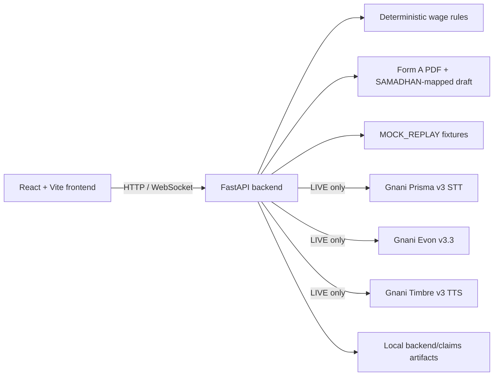

# Shramik-Nyay

Shramik-Nyay is a voice-led statutory wage redressal studio. The current implementation
provides a deterministic `MOCK_REPLAY` flow so the telemetry console can be developed
without consuming external Gnani credits.

## Architecture



The browser owns presentation, microphone capture, and browser-voice fallback. The
backend owns session orchestration, deterministic arithmetic, statutory narrative
generation, and draft artifact creation. External Gnani services are isolated behind
the backend and are never contacted by the mock replay.

## Run locally

### Backend

```powershell
cd backend
python -m venv venv
.\venv\Scripts\activate
python -m pip install -r requirements.txt
uvicorn main:app --reload --port 8000
```

The health endpoint is available at `http://127.0.0.1:8000/health`.

### Frontend

```powershell
cd frontend
npm run dev
```

Open the Vite URL, connect the bridge, and select **Run sample claim** to exercise the
synthetic worker profile, transcript, claim details, statutory checks, and read-back in the
four-panel studio. Select **Prepare draft PDF and JSON** to create downloadable claim
artifacts; the JSON is an illustrative SAMADHAN-mapped draft, not the official API
schema, and this demo does not submit or file anything with SAMADHAN.

Run the local checks from the repository root with:

```powershell
Set-Location .\backend
python -m unittest discover -p "test_*.py"
Set-Location ..\frontend
npm install
npm test
npm run build
npm run lint
```

Use the language selector to choose automatic detection or Hindi, Kannada, or English.
Automatic mode uses Prisma's `indic-auto` setting for live speech and detects the script
of typed text; Hindi is the fallback when the language is ambiguous. The sample replay,
follow-up questions, browser speech, number-to-words read-back, and Timbre request follow
the selected or detected language.

## Modes

- `MOCK_REPLAY` uses synthetic records and local statutory arithmetic.
- `LIVE` is reserved for configured Gnani credentials and endpoint access. Credentials
  remain local in `backend/.env`, which is intentionally ignored by Git.
- Configure `GNANI_API_BASE_URL`, `GNANI_STT_WS_URL`, and `GNANI_TTS_API_URL` in
  `backend/.env` for provider routing. `EVON_ENDPOINT_URL` is an optional full-URL
  override; otherwise the backend appends the Evon chat-completions path to the base URL.
- The sample conversation replay is available in `MOCK_REPLAY`; it does not call live
  Gnani services or a real worker registry. In `LIVE`, **Replay recorded call** sends
  the bundled `backend/fixtures/replay_recorded_call.pcm` fixture through the real
  Prisma pacer and provider. The fixture is synthetic (a one-time Timbre-generated
  speech source with deterministic procedural site noise), not a recording of a real
  worker. Claim artifacts are drafts for review, not submissions.

The microphone/Prisma speech-to-text path is available only in `LIVE` mode. In
`MOCK_REPLAY`, the backend and sample-claim flow work, but microphone transcription is
intentionally disabled to avoid external API calls and credit usage. To opt in, set
`SHRAMIK_MODE=LIVE` in `backend/.env` and configure valid Gnani credentials and endpoint
before restarting the backend. Live speech supports automatic detection and explicit
Hindi (`hi-IN`), Kannada (`kn-IN`), and English (`en-IN`) selection. The language can only
be changed while the microphone is stopped.

### MOCK_REPLAY setup

Copy the example configuration, leave the mode as `MOCK_REPLAY`, and start both
processes:

```powershell
Copy-Item .\backend\.env.example .\backend\.env
# No live key is required for MOCK_REPLAY.
Set-Location .\backend
.\venv\Scripts\activate
uvicorn main:app --reload --port 8000
```

Then run `npm run dev` from `frontend`. This mode uses fixtures and does not call Gnani.

### LIVE setup

Use a locally untracked `backend/.env`, set `SHRAMIK_MODE="LIVE"`, and provide valid
provider credentials and endpoints:

```dotenv
SHRAMIK_MODE="LIVE"
GNANI_API_KEY="replace-with-a-rotated-key"
HF_TOKEN=""
GNANI_API_BASE_URL="https://api.vachana.ai"
GNANI_STT_WS_URL="wss://api.vachana.ai/stt/v3/stream"
GNANI_TTS_API_URL="wss://api.vachana.ai/api/v1/tts"
```

The live path consumes provider credits and requires network access, valid account
permissions, and compatible provider availability. Never paste the key into source,
issues, test output, screenshots, or committed files.

Wage calculations are deterministic in `backend/legal_rules.py`; the LLM only drafts
the narrative and does not calculate amounts. The rule module includes a legal-review
notice because statutory applicability and compensation limits must be verified before
filing. Run its focused tests from `backend` with `python -m unittest test_legal_rules`.
The generated Form A draft lays out the five Stage B clauses and computed amounts in
Hindi, Kannada, or English. Devanagari and Kannada text uses the OFL-licensed Noto fonts
bundled in `backend/fonts`; uncaptured postal addresses are marked as not provided.
PDF text extraction coverage is in `backend/test_form_a_pdf_generator.py`.

The Prisma bridge sends only raw mono `pcm_s16le` frames of 1024 bytes at a 64 ms
cadence and supports the documented `update_settings` bias control frame.
In `LIVE` mode, the review script is also sent to Timbre v3.0 (Shivani voice), and its
WAV read-back is delivered to the browser. If synthesis fails, the UI reports that and
falls back to the browser voice. Run the offline Prisma, Evon, and Timbre checks from
`backend` with `python -m unittest discover -p "test_*.py"`; these tests mock network
clients and do not call Gnani APIs or consume credits.

## Optional live API diagnostic

See [`docs/live-verification.md`](docs/live-verification.md) for what the
one-shot verifier tests, required environment settings, and the exact command.
It checks Hugging Face repository access, synthesizes a short Timbre sample, and
sends that sample to Prisma; it does not call the Evon chat-completions endpoint.
This diagnostic can consume API credits and should not be run automatically.

Run it only once after confirming that credentials in `backend/.env` are valid:

```powershell
Set-Location .\backend
python .\verify_live_apis.py
```

The generated WAV is ignored by Git.

## Limitations and secret-safety status

- The generated Form A and SAMADHAN-mapped JSON are review drafts. They are not an
  official filing, legal advice, or a submission to SAMADHAN.
- `LIVE` behavior depends on external Gnani APIs; offline tests mock those clients and
  do not prove provider availability, latency, quotas, or account permissions.
- Browser speech synthesis is a fallback and varies by browser/OS. Microphone capture
  requires permission and a secure browser context in some deployments.
- Claim artifacts are stored locally under `backend/claims`; there is no production
  authentication, multi-user isolation, durable database, or retention policy.
- `backend/.env` is currently ignored (`.gitignore`) and is not tracked. Current
  tracked source contains placeholders/test values only, but the Git history audit found
  previously committed credential values in older commits. Therefore the repository
  cannot honestly be described as having a clean secret history: rotate those
  credentials immediately and rewrite/remove the affected history before publishing.
  Logs and test fixtures must continue to use placeholders such as `offline-test-key`.
